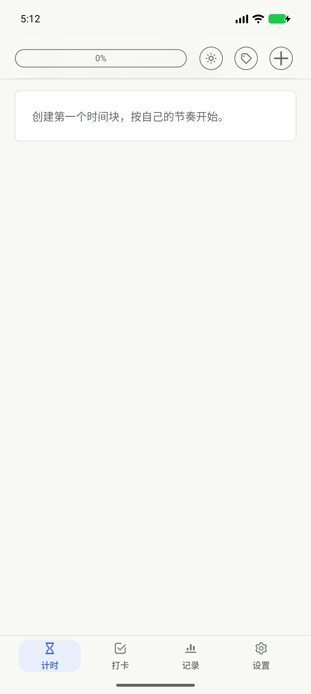

# Clock

一款本地优先的 Android 专注计时与每日习惯工具。无账号、无广告、无分析 SDK，无需联网。

<p></p>

[](https://github.com/TVU-banana/minimal-pomodoro/actions/workflows/android.yml)
[](LICENSE)
[](app/build.gradle.kts)

## 功能

- **专注计时**：可自定义启动阶段与正式专注；默认总计 60 分钟，包含 15 分钟启动阶段。
  支持暂停、恢复、提前结束与提醒，倒计时按时间戳恢复。
- **每日习惯**：独立于计时记录，每日目标 1–99 次，支持备注、历史补记与归档。
- **本地报告**：日、月、年度统计、分页热力图与可选模块的专注海报。
- **数据可迁移**：CSV 与版本化 `.clockbackup` v4，兼容导入 v1–v3。
- **原生界面**：Kotlin、XML Views、自定义 Canvas，支持深浅主题与大字体。

启动阶段是一项可调整的产品设计，不代表任何人在 15 分钟后必然进入心流。

## 快速构建

需要 **JDK 21**、Android SDK Platform **37.0**、Build Tools **36.0.0**。
Kotlin/Java 源码目标为 JVM 17；Gradle Daemon 使用仓库锁定的 JDK 21。
Android Studio 可通过 SDK Manager 安装 SDK；命令行环境运行：

```sh
sdkmanager "platforms;android-37.0" "build-tools;36.0.0"
export ANDROID_HOME="<你的 Android SDK 目录>"
./gradlew :app:assembleDebug
```

产物：`app/build/outputs/apk/debug/app-debug.apk`。最低支持 Android 8.0（API 26）。
首次构建需要联网下载构建依赖；应用自身不申请 `INTERNET` 权限。

```sh
# 完整 JVM 测试、Lint、构建与 APK 约束检查
./gradlew test lint assembleDebug assemblePreview assembleRelease assembleDebugAndroidTest :benchmark:assembleDebug
python3 scripts/check-apk.py app/build/outputs/apk/release/app-release-unsigned.apk

# 仅在专用测试设备或空白模拟器运行：测试会创建并清理测试数据
./gradlew :app:connectedDebugAndroidTest

# 发布前检查全部历史；Gitleaks 需要另行安装
python3 scripts/check-repository.py --history
gitleaks git --redact --log-opts=--all .
```

默认 Release 为无签名构建；正式签名通过环境变量提供，详见 [发布说明](docs/release.md)。
真机开发预览可使用 `./scripts/run-preview.sh`，详见 [贡献指南](CONTRIBUTING.md)。
不要用测试签名包覆盖正式安装；应用升级需要沿用原签名密钥。

## 工程设计

Room 是唯一事实来源，所有计时命令经过 `TimerCoordinator` 与可注入时间的纯 Kotlin reducer。
状态与检查点在事务中持久化；前台按 `elapsedRealtime` 推导剩余时间，后台仅在阶段边界设置
AlarmManager，无常驻 Service，也不进行每秒数据库写入。

| 目录 | 职责 |
| --- | --- |
| `app/src/main/java/com/akira/clock/timer` | 确定性计时状态机 |
| `app/src/main/java/com/akira/clock/alarm` | 命令协调、阶段提醒与恢复 |
| `app/src/main/java/com/akira/clock/data` | Room schema、事务与数据访问 |
| `app/src/main/java/com/akira/clock/habit` | 独立的每日习惯规则 |
| `app/src/main/java/com/akira/clock/export` | 备份兼容性、导入校验与导出 |
| `app/src/main/java/com/akira/clock/ui` | 生命周期、交互与渲染 |
| `app/src/test` / `app/src/androidTest` | JVM 与 Android 设备测试 |
| `benchmark` | 单独的启动与性能测量模块 |

CI 检查隐私与完整历史、JVM 测试、Android Lint、构建、APK 12 MiB 预算、禁用权限，
并在独立模拟器运行设备测试。性能测试与真实设备体验的证据边界见 [性能说明](docs/performance.md)。

## 文档

- [架构与职责边界](docs/architecture.md) · [架构决策记录](docs/decisions/)
- [开放数据格式](docs/data-format.md) · [隐私说明](docs/privacy.md)
- [发布与签名](docs/release.md) · [变更记录](CHANGELOG.md)
- [贡献指南](CONTRIBUTING.md) · [安全问题报告](SECURITY.md)
- [第三方许可](THIRD_PARTY_NOTICES.md) · [本次验证与已知限制](docs/publication-checks.md)

手环互联为可选实验功能，默认构建使用 stub，不包含专有 SDK；
构建与模拟协议测试不代表已通过手机与手环的端到端验收。见 [手环协议与限制](docs/band-control.md)。

## 许可证

项目源码使用 [GPL-3.0-or-later](LICENSE)。第三方字体保留各自的 SIL Open Font License。
