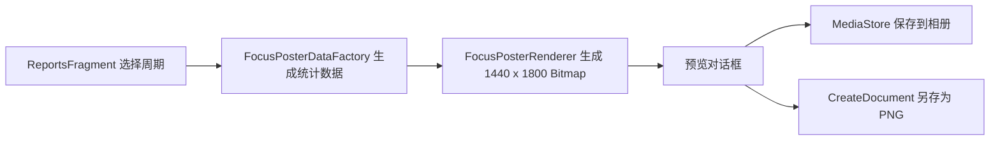
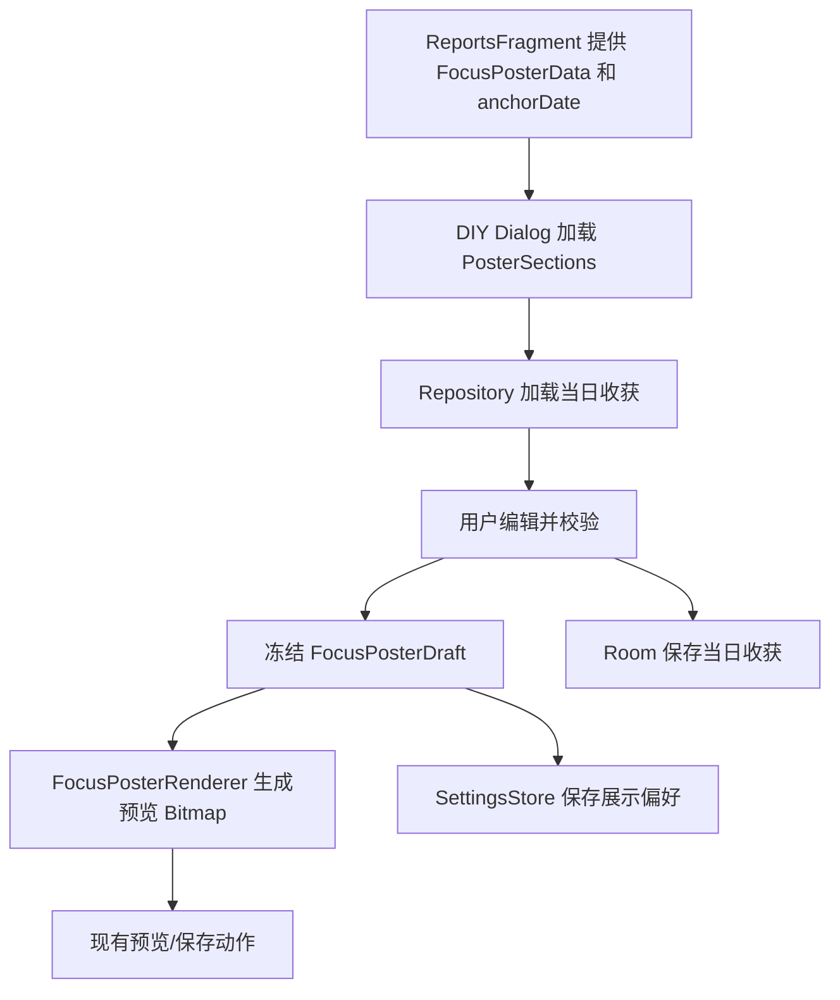

# 分享海报 DIY 与“本日收获”实施手册

## 1. 目标与交付边界

本次改动在保留现有海报视觉语言的前提下，增加海报内容 DIY 能力和“本日收获”模块。
实现完成后，用户点击“预览专注海报”时，可以通过复选框决定是否展示：

- 专注分布图：`DAY`、`WEEK` 为柱状图，`MONTH`、`YEAR`、`ALL_TIME` 为热力图；
- 本日收获：用户输入的当日总结，使用项目内置宋体；
- 激励语：当前文案“革命尚未成功，同志仍需努力”。

周期标题、日期范围和总专注时长是海报身份信息，不允许隐藏。首次使用时三个可选模块全部
勾选；用户成功预览或导出后，记住最后一次勾选组合，并提供“恢复默认”将三项重新全部勾选。

“海报样式不变”的验收含义是：继续使用 `1440 × 1800` PNG、现有圆角、边距、海报专用
颜色、宋体、标题/日期/总时长层级、柱状图或热力图画法和现有导出动作。允许为了容纳新模块
重新分配可选内容区的纵向高度，不得重做配色、字体、图表形态、文案风格或导出流程。

不在本次范围内：

- 不允许用户改颜色、字体、背景、字号、文案模板或画布比例；
- 不改变报告页的统计口径、默认 `DAY` 周期或报告列表；
- 不改变现有相册保存、另存为、取消按钮的语义和相对分组；
- 不引入 Compose、网络、持久 Service、反射式依赖注入或每秒数据库写入；
- 不顺带重构计时器、标签、今日页或其他已有未提交改动。

## 2. 开工前必须确认的当前基线

当前工作区存在大量未提交改动。实施 Agent 必须先运行 `git status --short` 和针对相关文件的
`git diff`，把这些改动视为用户资产；禁止使用 `git reset --hard`、`git checkout --` 或覆盖式
复制恢复文件。

当前实现链路如下：



实施前逐一打开并以当前工作区版本为准：

| 文件 | 当前职责 | 本次动作 |
|---|---|---|
| `app/src/main/java/com/akira/clock/ui/ReportsFragment.kt` | 周期加载、海报预览和导出 | 只保留生命周期与流程编排，把 DIY UI 移出 Fragment |
| `app/src/main/java/com/akira/clock/report/PosterModels.kt` | 海报统计模型与工厂 | 增加独立的展示配置/草稿模型，不改变统计口径 |
| `app/src/main/java/com/akira/clock/export/FocusPosterRenderer.kt` | Canvas 海报渲染 | 改为按草稿渲染可选模块，保留视觉 token |
| `app/src/main/java/com/akira/clock/data/Entities.kt` | Room 实体 | 增加每日收获实体 |
| `app/src/main/java/com/akira/clock/data/ClockDao.kt` | Room DAO | 增加每日收获 DAO |
| `app/src/main/java/com/akira/clock/data/ClockDatabase.kt` | 数据库及迁移 | 数据库 5 升 6，注册实体、DAO、迁移 |
| `app/src/main/java/com/akira/clock/data/SettingsStore.kt` | 轻量设置 | 仅保存三个展示偏好，不保存总结正文 |
| `app/src/main/java/com/akira/clock/export/*` | 开放备份及恢复 | 将每日收获纳入版本化、确定性备份 |
| `app/src/main/res/values/strings.xml` | 用户可见文案 | 增加 DIY、输入、校验文案，禁止 Kotlin 硬编码 |

先记录现有测试和 Lint 结果。历史上该工作区出现过与本功能无关的 Lint 问题；若仍存在，必须
把“新增回归”和“基线问题”分开报告，但不得因此跳过本功能验证。

## 3. 产品行为契约

### 3.1 入口和操作流程

保持报告页“预览专注海报”按钮不变。点击后打开新的海报 DIY 对话框或全屏
`DialogFragment`，而不是直接生成最终预览。推荐结构：

```text
专注海报 DIY
☑ 专注分布图
☑ 本日收获
┌──────────────────────────────┐
│ 写下今天完成了什么、学到了什么…… │
│                         0/120 │
└──────────────────────────────┘
☑ 激励语

恢复默认                         生成预览
```

点击“生成预览”后沿用现有海报预览和底部动作：左侧“另存为”，右侧“取消”和“保存到相册”。
从预览返回 DIY 时保留尚未提交的文字和勾选状态。保存或另存为必须使用预览时冻结的同一份
草稿，避免用户操作期间数据变化导致预览图和导出图不一致。

如果实现实时预览，Bitmap 渲染至少去抖 250 ms、取消上一次任务，并在替换图片、关闭对话框
或销毁 View 时回收旧 Bitmap。中等强度 Agent 优先实现“编辑 -> 生成预览”的两步流程，它更
容易保证生命周期和内存正确。

### 3.2 复选框规则

- 第一次使用：图表、本日收获、激励语全部勾选。
- 后续打开：读取上一次成功生成预览或成功导出时的组合；不要在每次点选时立即落盘。
- “恢复默认”：三项全部勾选，不清空已保存的本日收获。
- 至少允许导出仅含身份区的极简海报，不能强制至少选择一个可选模块。
- 取消 DIY 对话框：不保存本次勾选改动；已经自动保存的总结正文不回滚。
- 取消勾选本日收获：输入框隐藏或禁用，但保留文字；重新勾选后恢复。
- 勾选本日收获且正文为空白：禁止生成预览和导出，显示资源文案
  “请填写本日收获，或取消勾选该栏目”。不得把输入提示或空白卡片写入最终 PNG。

### 3.3 “本日收获”规则

- 一天一条，日期以当前报告锚点的本地日期为准。当前报告都以今天为锚点，因此各周期海报
  引用同一条“本日收获”；不要把周/月总结冒充本日总结。
- 正文 trim 首尾空白，保留内部换行；只输入空白等价于空内容。
- 上限为 120 个 Unicode code point，而不是 120 个 UTF-16 `Char`。禁止静默截断。
- 最多渲染 4 行。输入阶段用与 Canvas 相同的测量规则校验；超出时提示用户缩短，不用省略号
  偷偷丢失内容。
- 标题固定为“本日收获”，标题与正文均使用
  `source_han_serif_cn_extra_light_3.otf`。不得依赖设备系统宋体回退。
- 输入内容属于用户数据，保存到 Room，并加入完整备份；不得仅存于 Fragment、Bundle 或
  `SharedPreferences`。
- 空文本保存采用删除该日记录的语义，避免数据库中积累无意义空记录。

建议在输入停止 400 ms 后异步 upsert，或在输入框失焦/生成预览前保存。数据库操作在 IO
dispatcher 执行；界面销毁前要完成最后一次明确提交，且错误必须反馈，不能假装已保存。

## 4. 数据与接口设计

### 4.1 纯 Kotlin 海报草稿模型

在 `report` 包中增加纯 Kotlin 模型，示意如下。命名可微调，但职责不能混回 Android UI：

```kotlin
internal data class PosterSections(
    val showChart: Boolean = true,
    val showReflection: Boolean = true,
    val showMotivation: Boolean = true,
)

internal data class FocusPosterDraft(
    val data: FocusPosterData,
    val sections: PosterSections = PosterSections(),
    val reflectionText: String = "",
)
```

`FocusPosterDataFactory` 继续只负责统计数据。不要给它传 `Context`、复选框或持久化对象。
`FocusPosterRenderer.render()` 改接收 `FocusPosterDraft`。如果为了小步迁移暂时保留
`render(FocusPosterData)`，它必须委托给默认全展示草稿，且在调用点迁移完后删除，防止两套
行为长期并存。

另建纯 Kotlin `PosterLayoutPlanner`：输入 `PosterSections`，输出标题区、图表区、收获区和
激励语区的矩形/基线。Renderer 只消费布局结果，不在多个 `if` 分支里散落 magic number。
这使 8 种勾选组合都能用 JVM 单元测试验证无重叠、无越界。

### 4.2 每日收获实体

推荐新增：

```kotlin
@Entity(tableName = "daily_reflections")
internal data class DailyReflectionEntity(
    @PrimaryKey val localDateIso: String,
    val timezoneIdAtWrite: String,
    val text: String,
    val createdAtUtcMs: Long,
    val updatedAtUtcMs: Long,
)
```

`localDateIso` 必须是 `yyyy-MM-dd`，作为用户可理解、备份可读的一日键。`timezoneIdAtWrite`
保留创建时语境，不参与主键；用户旅行后查看同一日历日期仍能找到该条记录。DAO 至少提供：

```kotlin
@Query("SELECT * FROM daily_reflections WHERE localDateIso = :date LIMIT 1")
suspend fun get(date: String): DailyReflectionEntity?

@Upsert
suspend fun upsert(reflection: DailyReflectionEntity)

@Query("DELETE FROM daily_reflections WHERE localDateIso = :date")
suspend fun delete(date: String)

@Query("SELECT * FROM daily_reflections ORDER BY localDateIso, updatedAtUtcMs")
suspend fun allForExport(): List<DailyReflectionEntity>
```

在 Repository 中集中做 trim、code-point 上限、日期格式和时间戳规则；Fragment 不直接拼实体。
新增内部契约 KDoc，解释“一日一条”、空文本删除、线程和失败行为。

### 4.3 Room 迁移

- 数据库版本从 5 升到 6；新增实体和 `dailyReflectionDao()`。
- `MIGRATION_5_6` 只创建 `daily_reflections`，不得改动既有表或数据。
- SQL 列的 `NOT NULL`、主键和字段名必须与 Room 生成 schema 完全一致。
- 更新 `app/schemas/com.akira.clock.data.ClockDatabase/6.json`，不要手写 schema JSON。
- 增加 instrumentation migration test：从 schema 5 创建数据库，写入一条既有 Session，迁移
  到 6 后验证旧数据仍在、收获表可读写。
- 禁止 `fallbackToDestructiveMigration()`。

### 4.4 DIY 偏好

三个布尔值是展示偏好，可放入 `SettingsStore`：

- `poster_show_chart`；
- `poster_show_reflection`；
- `poster_show_motivation`。

缺少 key 时都返回 `true`。提供一次性读取/写入 `PosterSections` 的方法，避免 UI 连续三次写
Preferences 形成部分状态。正文严禁放入 `SettingsStore`。

### 4.5 开放备份契约

每日收获是用户生成内容，必须进入 `.clockbackup`，否则“完整备份”会名不副实：

- `BackupBundle` 增加 `reflections`，按 `localDateIso` 稳定排序；
- 新增 `reflections.ndjson`，每行包含 `localDate`、`timezoneIdAtWrite`、`text`、`createdAt`、
  `updatedAt`；文本按既有 `JsonCodec` 转义；
- `OpenBackupCodec` 增加确定性编码/解码和文件常量；
- `BackupValidator` 校验日期、ZoneId、非空正文、120 code point 上限、时间戳顺序和日期唯一性；
- `BackupMerger` 同日期冲突保留 `updatedAtUtcMs` 较新的记录；相同时间戳采用确定性规则，推荐
  保留本地记录并写测试锁定；
- `ClockBackupService.readBundle()`、导入事务和所有 fixture 同步加入 reflections；
- `ClockBackupArchive` 允许并校验新文件。

将 `BACKUP_SCHEMA_VERSION` 升到 2。读取器同时接受 v1 和 v2：v1 没有
`reflections.ndjson` 时映射为空列表；v2 要求该文件存在，即使内容为零字节。写出只生成 v2。
禁止简单把读取条件改为“只接受 2”，否则用户已有 v1 备份会全部失效。同步更新
`docs/data-format.md` 的版本、目录树、兼容规则和字段说明。

DIY 展示偏好不是用户内容，不进入完整备份；恢复数据不应意外改变用户当前海报偏好。

## 5. UI 拆分与状态流

新增 `PosterCustomizeDialogFragment` 和对应 XML layout。继续使用 XML/View；不要在
`ReportsFragment` 内用数百行动态 View 拼装第二套对话框。建议状态流：



需要避免以下状态错误：

- 周期切换的旧协程晚返回，覆盖新周期 `pendingPoster`；给 load 请求加 generation token，或取消
  前一个 Job，只接受当前周期结果。
- `pendingPoster` 只保存统计数据，导出时丢失用户勾选和正文；改为保存冻结的 draft。
- 预览 Bitmap 被取消和按钮点击重复 recycle；封装单一所有权，释放动作必须幂等。
- Fragment View 已销毁后继续访问 `requireContext()` 或更新 UI；协程绑定
  `viewLifecycleOwner.lifecycleScope`。
- 屏幕旋转丢失未提交输入；用 `savedInstanceState` 或轻量 ViewModel 保存草稿 UI 状态，正文
  最终仍以 Room 为事实来源。

所有用户可见字符串放到 `strings.xml`。复选框、输入框和按钮要有可读 label，触摸目标至少
48dp，并在 light/dark 两个主题下验证文字、勾选符号和输入提示的对比度。

## 6. Canvas 布局和字体规则

保留现有常量：`WIDTH = 1440`、`HEIGHT = 1800`、`MARGIN = 112f`、海报圆角 48、卡片圆角
32，以及现有 `poster_*` 配色。身份区保持当前位置和字号：周期标题、日期范围、总时长不得随
可选模块跳动。

把 `y = 520..1510` 定义为可选内容区，模块间距 32 px；`y = 1510..1800` 优先作为激励语区。
布局策略按以下规则实现并由 `PosterLayoutPlannerTest` 锁定：

| 可见模块 | 布局要求 |
|---|---|
| 图表 + 收获 + 激励语 | 图表在上、收获在下、激励语保持右对齐底部区；三者不重叠 |
| 图表 + 收获 | 图表和收获占满内容区，底部保留原海报呼吸空间 |
| 仅图表（可带激励语） | 恢复当前图表卡 `520..1450` 的视觉比例 |
| 仅收获（可带激励语） | 收获卡从 520 开始，不伪造空图表卡；正文垂直靠上 |
| 图表、收获均隐藏 | 不绘制空卡；保留身份区和自然留白 |

“专注分布图”复选框控制整个图表卡，包括图表标题、轨道、柱/格和轴标签。隐藏时不能留下
卡片背景或标题。“激励语”控制完整文案，隐藏后不能留下占位符。

收获卡沿用现有 `poster_surface`、32 px 圆角和左右内边距 56 px。建议宋体排版：标题 34 px、
正文 44 px、行距 64 px；如果真机评审证明可读性不足，可只微调这三个新模块参数，不改现有
海报元素。正文换行必须用 `Paint.breakText` 或等价的 code-point 安全算法按实际宽度测量；
尊重用户换行，禁止按字符数粗暴切行。

Renderer 中现有“每日专注时长”“每小时专注分布”“每日专注强度”和激励语是硬编码中文。
本次触及这些分支时一并移入 `strings.xml`，Renderer 通过 resources 获取，满足项目的用户文案
规则，但不要改文案本身。

## 7. 推荐实施顺序

每一步保持可编译，避免一次改完后难以定位问题。

1. **保护基线**：记录 status/diff、当前测试和 Lint；确认不覆盖用户改动。
2. **纯模型**：增加 `PosterSections`、`FocusPosterDraft`、正文校验器和布局规划器及 JVM 测试。
3. **Renderer**：按 draft 条件渲染 8 种组合；先使用测试 fixture，不接 UI。
4. **Room**：增加每日收获实体、DAO、Repository、5→6 迁移和 migration test。
5. **备份**：升级 schema v2，完成 v1 兼容读取、v2 round-trip、merge 和损坏输入测试，并更新
   `docs/data-format.md`。
6. **DIY UI**：新增 DialogFragment/XML，接入复选框、输入、校验、恢复默认和状态恢复。
7. **预览/导出**：让预览、相册保存、另存为全部使用同一冻结 draft；验证 Bitmap 生命周期。
8. **完整验证**：单测、instrumentation、Lint、构建、安装，再做真机 light/dark 和导出 PNG 检查。

如果中途需要拆分提交，推荐按“模型与渲染”“Room 与备份”“UI 与导出”“测试与文档”拆分；
不要提交用户原本的无关改动。

## 8. 必须新增或更新的测试

### 8.1 JVM 单元测试

- `PosterSections` 默认三项为 true，恢复默认结果一致。
- 正文 trim、空白、中文/emoji code point 计数、120 边界和 121 拒绝。
- 8 种勾选组合的布局都在 `0..1440 × 0..1800` 内，模块互不重叠。
- 图表隐藏时没有图表 bounds；激励语隐藏时没有其 baseline；收获隐藏时没有收获 bounds。
- `DAY/WEEK` 仍选择柱状图，其他三个周期仍选择热力图。
- 现有 `posterIncludesWarmupDurationInTheFocusTotal` 必须继续通过。
- 文本换行尊重显式换行，不拆 surrogate pair，超过 4 行返回校验错误。
- `OpenBackupCodecTest`：含中文、换行和 emoji 的收获可确定性 round-trip。
- `ClockBackupArchiveTest`：v1 可导入且 reflections 为空，v2 缺少 reflections 文件被拒绝。
- `BackupMergerTest`：同日记录按更新时间合并，结果稳定。

不要用大面积像素 golden 取代布局单测；抗锯齿和系统差异会让它脆弱。可补少量 Bitmap 像素/
非空区域断言，但最终视觉仍由真机确认。

### 8.2 Instrumentation 测试

- Room 5→6 迁移保留旧数据并创建可读写的每日收获表。
- DIY 对话框首次全选、取消不保存偏好、生成预览后保存偏好。
- 勾选空收获时阻止预览；取消勾选后允许预览。
- 旋转后输入、勾选项和当前周期不丢失。
- 相册保存和另存为使用同一 draft，导出成功后 PNG 可解码且尺寸为 `1440 × 1800`。

### 8.3 回归矩阵

| 场景 | 预期 |
|---|---|
| 当日，三项全开 | 24 小时柱状图、收获、激励语都存在 |
| 本周，图表开启 | 7 日柱状图不变 |
| 本月/本年/全部，图表开启 | 仍为热力图，不误画柱状图 |
| 三项全关 | 仅身份区，无遮挡、无空卡 |
| 仅收获 | 宋体正文可读，无图表残影 |
| 仅激励语 | 文案仍右对齐，无图表/收获占位 |
| 无专注记录但有收获 | 报告页当前可能隐藏海报入口；产品期望应允许用户总结并导出，因此入口可见性要改为“有统计内容或有本日收获”。若尚未输入，仍应允许打开 DIY 填写 |
| 保存失败 | 明确报错，不显示成功 Toast，不丢失正文 |

最后一行是本次必须修正的既有耦合：当前 `exportPoster.isVisible = hasContent` 会让“没有专注记录但
想写本日收获”的用户无法进入 DIY。应把入口在 `DAY` 至少保持可见；其他周期也建议保持可见，
让用户能导出仅含身份区/本日收获的海报。空统计的总时长显示 `0min`，图表仍可由用户隐藏。

## 9. 验证命令与证据分层

遵守 `AGENTS.md`：Kotlin 行宽不超过 100、imports ASCII 排序、用户文案资源化、KDoc/注释英文、
完整测试和 Android Lint 通过后才能宣称完成。按本机可用 JBR 执行：

```bash
JAVA_HOME='/Applications/Android Studio.app/Contents/jbr/Contents/Home' \
GRADLE_USER_HOME=/private/tmp/clock-gradle-home \
./gradlew :app:testDebugUnitTest :app:lintDebug :app:assembleDebug \
  --offline --no-daemon --max-workers=1 --console=plain
```

有在线设备时再运行 instrumentation；执行前确认设备状态：

```bash
"$ANDROID_HOME/platform-tools/adb" devices

JAVA_HOME='/Applications/Android Studio.app/Contents/jbr/Contents/Home' \
GRADLE_USER_HOME=/private/tmp/clock-gradle-home \
./gradlew :app:connectedDebugAndroidTest \
  --offline --no-daemon --max-workers=1 --console=plain
```

验收报告必须把证据分开：

1. **静态实现**：修改文件、数据库/备份版本、架构边界；
2. **自动化测试**：具体任务及通过数量；
3. **Lint/构建**：独立报告，不用 build 代替 Lint；
4. **设备运行**：安装和启动成功；
5. **真机视觉**：light/dark 下 DIY 控件、8 种当日组合、周柱状图、月热力图；
6. **导出验收**：相册和另存为文件尺寸、内容与预览一致；
7. **备份验收**：v2 导出、恢复收获、v1 旧备份仍能导入。

构建、安装或打开页面都不能单独证明视觉和导出正确。最终至少保留全展示、仅收获、全隐藏、
周柱状图、月热力图的真机截图，以及一张从相册重新打开的最终 PNG。

## 10. 完成定义与停止条件

以下条件全部满足才可交付：

- 三个模块可独立勾选，首次全开，组合偏好按契约保存；
- 本日收获可输入、持久化、恢复、删除、校验，并使用内置宋体进入 PNG；
- 8 种组合无重叠、裁切、空卡或意外占位；
- 五个周期标题、两类图表和原统计口径未回归；
- 预览、相册保存、另存为使用同一冻结草稿；
- Room 5→6 无损迁移，备份 v2 包含收获且兼容读取 v1；
- 完整测试、Lint、构建通过，真机 light/dark 与导出检查完成；
- 没有覆盖或混入用户原有的无关工作区改动；
- `docs/data-format.md` 和必要的架构说明与实现一致。

遇到以下情况必须停止并向用户说明，不得自行扩大范围：需要改变海报配色/字体/尺寸、需要删除
既有数据、无法兼容 v1 备份、必须覆盖用户未提交改动，或真机结果证明 120 code point/4 行在
现有画布中不可读。最后一种情况应附截图和实测行宽，再请求用户选择更短上限或新的海报比例。
